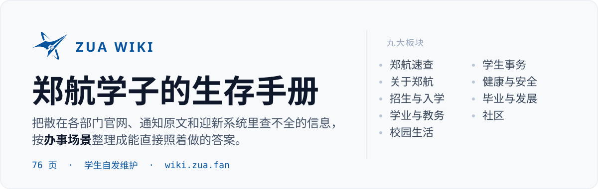
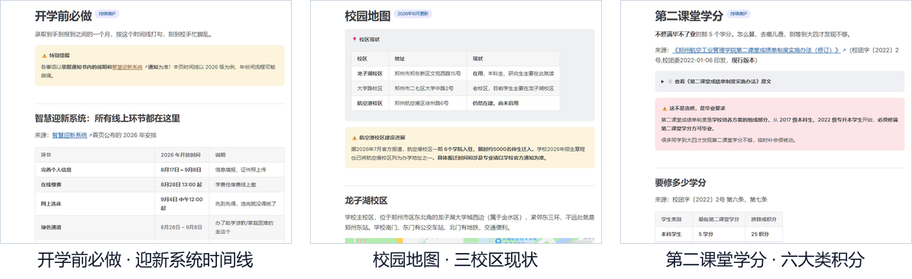

<p align="center">
  
</p>

<p align="center">
  <a href="https://vitepress.dev/"></a>
  <a href="./LICENSE"></a>
  
  <a href="https://wiki.zua.fan"></a>
</p>

**郑航百科全书**（ZUA Wiki）是由郑州航空工业管理学院学生自发编写的**非官方**经验手册，76 页，涵盖报考、入学、选课、宿舍、医保到毕业求职。

线上地址：**[wiki.zua.fan](https://wiki.zua.fan)**

> [!WARNING]
> 本站与学校无隶属关系，内容**与官方冲突时一律以官方为准**。

## 长什么样

三张真实页面——时间线、表格、积分对照都直接给结论，来源内联在数据旁边：

<p align="center">
  
</p>

## 它跟"把通知抄一遍"有什么不同

- **按办事场景分，不按学校机构分**。找"转专业"不用先猜这归教务处还是学工部管，直接进「学业与教务」。
- **来源内联到数据旁边**。每块数据后面跟着是哪个部门、哪份通知、哪天发布的链接，能当场核对。
- **查不到就写「待补充」，绝不编数字**。所以站内会有"本页暂无权威出处"——那不是偷懒：录取分数线表、社团名单、外卖取餐点这类必然过时的东西**故意不抄**，只教你怎么用官方系统查。
- **旧版本冻结归档**。招生章程、计划这类年度文件，新版替换正文，旧版移进 `docs/archive/` 留档，方便对比政策变化。

## 站点结构

| 板块 | 放什么 |
| :--- | :--- |
| **郑航速查** | 常用网站、部门与电话、全年时间表——高频刚需，一步到位 |
| **关于郑航** | 学校简介、校史与校庆、特色项目、校园地图、校园地标、映像郑航 |
| **招生与入学** | 招生章程、招生计划、历年录取分数、特殊类型招生、学院与专业、新生入学全链条 |
| **学业与教务** | 选课、教务系统与校历、考试与成绩、图书馆、转专业、辅修与交流 |
| **校园生活** | 宿舍、日常消费、网络、食堂超市外卖、快递打印洗浴、交通与周边美食 |
| **学生事务** | 证件与学籍、党团组织、学生组织与社团、第二课堂学分、奖助与资助、请假与留校 |
| **健康与安全** | 校医院、医保与转诊、附近医院、心理咨询与危机、体测、校园安全、防骗 |
| **毕业与发展** | 考证与竞赛、保研、考研、考公考编、就业与实习、毕业与学位 |
| **社区** | 新生群识别、招新群、课程竞赛群、老乡群、开学防坑 |

不知道某个具体问题该去哪页，先看线上的「郑航速查」，那里有"新生第一步"和"在校生高频入口"两张导航表。

## 本地构建

```bash
npm install
npm run docs:dev        # 本地开发，http://localhost:5173
npm run docs:build      # 构建静态站，产物在 .vitepress/dist
npm run docs:preview    # 预览构建结果
```

<details>
<summary>目录结构（点击查看）</summary>

<br>

```text
ZUA-wiki/
├── .vitepress/
│   ├── theme/
│   │   ├── custom.css               # 品牌色、导航栏微调
│   │   └── index.js                 # 主题入口（图片查看器等）
│   └── config.mjs                   # 站点配置：导航、侧栏分组、搜索、页脚
├── docs/                            # 全部内容，srcDir 指到这里
│   ├── index.md                     # 首页（VitePress home layout）
│   ├── quick/          (4 页)       # 郑航速查
│   ├── aboutZUA/       (6 页)       # 关于郑航
│   ├── enroll/         (11 页)      # 招生与入学
│   ├── study/          (7 页)       # 学业与教务
│   ├── life/           (13 页)      # 校园生活
│   ├── affairs/        (6 页)       # 学生事务
│   ├── health/         (8 页)       # 健康与安全
│   ├── future/         (6 页)       # 毕业与发展
│   ├── community/      (6 页)       # 社区
│   ├── aboutUs/        (1 页)       # 关于本项目
│   ├── archive/                    # 历史版本归档（内容冻结，不再更新）
│   │   ├── index.md                # 归档目录与归档规则
│   │   ├── 2024/                   # 章程、计划、新生入学、学长学姐说
│   │   └── 2025/                   # 章程、计划
│   └── public/                     # 静态资源，构建后位于站点根路径
│       ├── favicon.svg
│       ├── img/                    # 站内图片（artical / docs / photo）
│       └── pdf/                    # 官方文件原文（官网禁止跨站嵌入，存一份）
├── assets/readme/                  # 本 README 用的图
├── .gitignore
├── AGENTS.md                       # 写作规范：改内容前先读这个
├── LICENSE                         # MIT
├── package.json
└── README.md
```

</details>

## 免责与版权

> [!WARNING]
> - 本站是**学生自发维护**的经验站，内容来自学校官网、各部门通知、迎新系统、录取通知书、官方公众号推文以及学长学姐的实践经验（后者会明确标注为社区经验）。
> 
> - 招生、政策、收费类内容**每年都可能变**。办理重要事务前，请务必核对学校当年的官方通知。
> 
> - 本站内容精心编写，是各位贡献者的劳动成果。**任何复制、转载请注明出处，严禁用于商业用途。**
> 

代码与站点构建采用 [MIT License](./LICENSE)；文字内容的转载要求以上一条为准。
